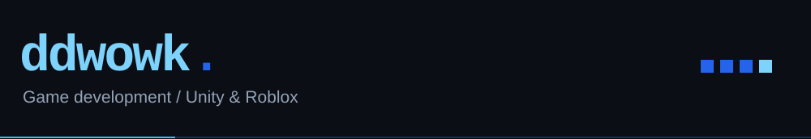

<picture>
<source media="(max-width: 640px)" srcset="./assets/header-mobile.svg" />

</picture>

I work on gameplay systems, multiplayer, and UI in **Unity** and **Roblox**.

`C#` · `Luau` · `Unity` · `Roblox Studio` · `Git`

### Activity

### Projects

- [Escape Thiang Than Nuang](https://github.com/ddwowk/Escape-Thiang-Than-Nuang)
- [Godskin Duo / BrainRotFight](https://github.com/ddwowk/229c-Godskin-Duo-BrainRotFight)
- [Somo Game Sood Hod](https://github.com/ddwowk/GI204_SomoGameSoodHod)

[All repositories ↗](https://github.com/ddwowk?tab=repositories)
